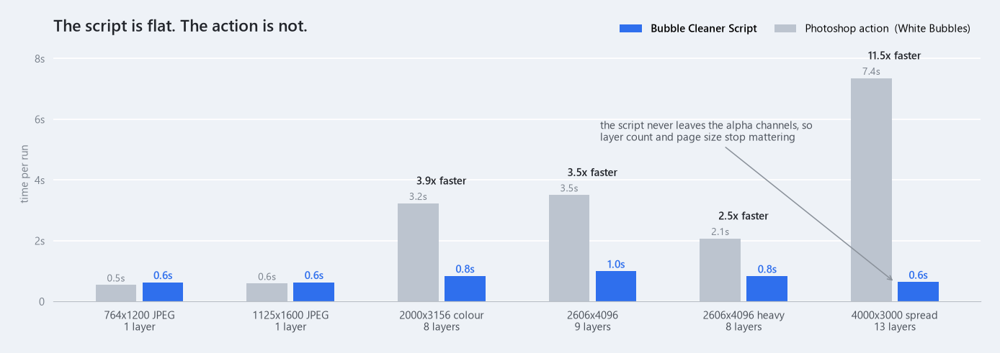
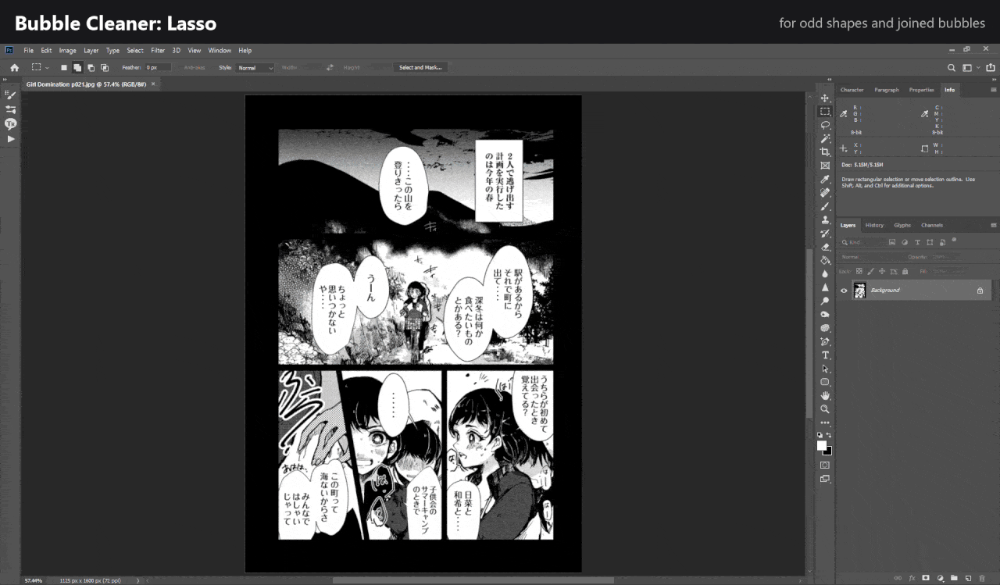
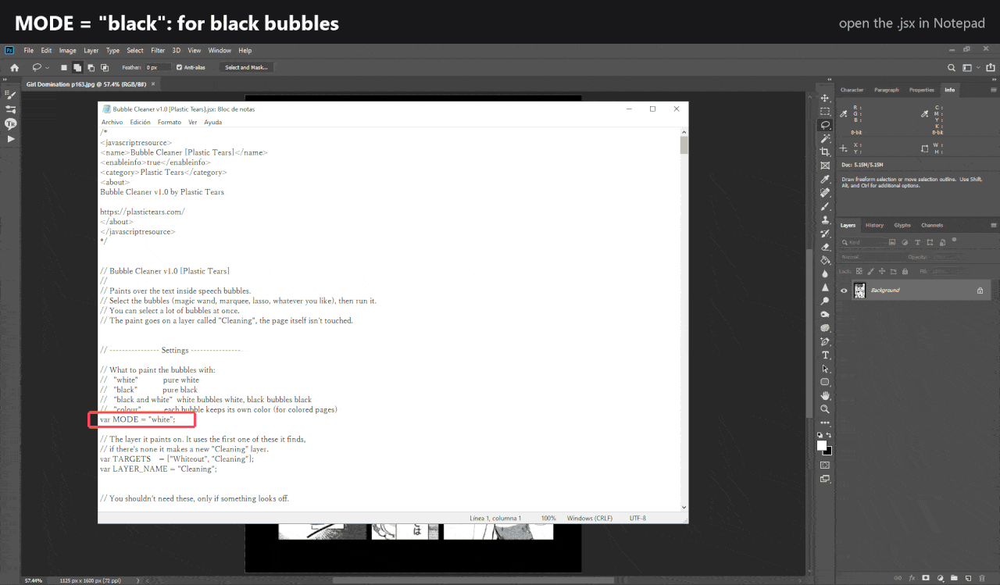
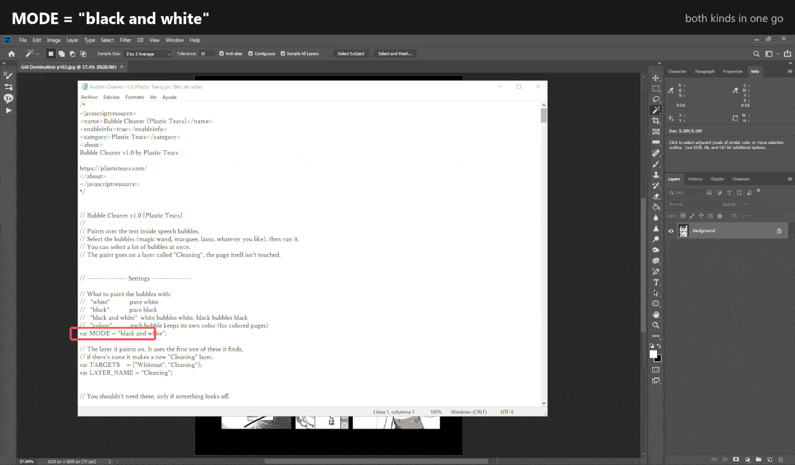
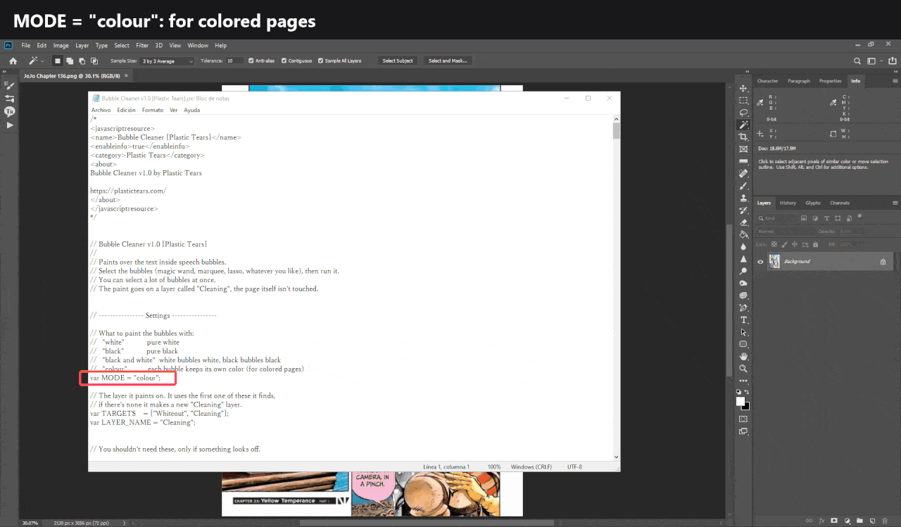

# Bubble Cleaner

A Photoshop script that erases the text inside speech bubbles.
You select the bubbles, run the script, and it paints over the text, leaving clean, empty bubbles. The drawing around the bubbles isn't touched.

Made to replace the current bubble cleaing actions going around.

![Bubble Cleaner in Photoshop: magic wand at tolerance 10, shift-click the bubbles, File > Scripts > Bubble Cleaner [Plastic Tears]](docs/gifs/1-magic-wand.gif)

WAY faster than the current actions, doesn't get any slower on big documents or heavy layered ones. Takes under a second in any page on my T480, to it's probably way faster on your machine



## Installation

1. Place `Bubble Cleaner v1.0 [Plastic Tears].jsx` in Photoshop's Scripts folder:
   - **PC:** `C:\Program Files\Adobe\Adobe Photoshop <version>\Presets\Scripts\`
   - **Mac:** `/Applications/Adobe Photoshop <version>/Presets/Scripts/`
2. Restart Photoshop.
3. Run it via **File > Scripts > Bubble Cleaner [Plastic Tears]**.

Or skip the install and pick the file with **File > Scripts > Browse...**

## How to use it

1. Open your image in Photoshop.
2. Select the bubbles you want to clean. Use the Magic Wand, or just draw a box around the text. You can select a lot of them at once. (If you use the magic wand, I suggest using a 5 to 15 tolerance)
3. Run the script.

That's it. The paint goes on its own layer called **Cleaning**, so the original page is never changed.

Note: Once it's installed, you can make an action to run it, I personally have one mapped to F3 so every time i click that it runs the script.

### Other ways to select

**Rectangular Marquee.** For bubbles the wand can't grab cleanly. The box only has to cover the text, it fills the whole bubble anyway.


**Lasso.** For weird shapes and bubbles stuck together. Rough loops are fine.



You can mix them too, wand some bubbles and box the rest, then run it once.

## White, black or colored bubbles

By default it paints **white**. To change it, open `Bubble Cleaner v1.0 [Plastic Tears].jsx` with Notepad and change this line near the top:

```
var MODE = "white";
```

| Write | And it paints |
|---|---|
| `"white"` | white |
| `"black"` | black |
| `"black and white"` | white bubbles white, black bubbles black |
| `"colour"` | each bubble in its own color (for colored pages) |

Save the file and run it again, no need to restart Photoshop.

**`"black"`**



**`"black and white"`**: white and black bubbles in the same selection, one run.



**`"colour"`**: pink stays pink, cyan stays cyan. Slower than the others, a few seconds per color. On big pages with big lettering, wand at a tolerance of 15: lower than that, the wand doesn't get between the letters and the text block is left as one big hole, which the script won't paint over (that's what keeps it off the art). JPEG noise does the same, so clean noisy pages first.


Due to the GIF compression this image might look a little funky but the colors won't get ever touched or changed while using the script.

## If something looks off

Below that line there are a few more settings, each one explained as "if you see this, change this". Most people never need them.

## Feedback

Tested on pages ranging from 760px to 4096px, grayscale and color. Only in Photoshop 2019 Bugs or ideas: open an issue here, or message me on Discord (**luigidesu**).
